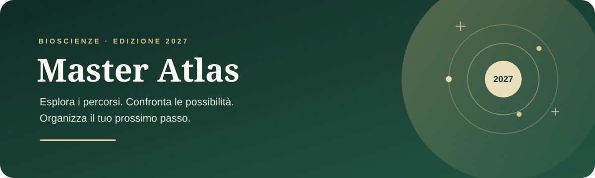

<p align="center">
  
</p>

<p align="center">
  <a href="https://micheledifiglia.github.io/coddiamo/"><strong>Apri l’app</strong></a>
  ·
  <a href="master-atlas-2027/README.md">Guida tecnica</a>
  ·
  <a href="CONTRIBUTING.md">Contribuire</a>
</p>

<p align="center">
  <a href="https://github.com/micheledifiglia/coddiamo/actions/workflows/deploy-pages.yml"></a>
  <a href="https://micheledifiglia.github.io/coddiamo/"></a>
  
</p>

# Master Atlas 2027

Un atlante interattivo per esplorare **208 percorsi magistrali in bioscienze**, confrontare le opzioni e organizzare le candidature. Riunisce in un’unica app le quattro classifiche del dossier originale, mantenendo visibili le differenze tra master, track, M1/M2 e programmi congiunti.

Le graduatorie sono valutazioni personali e qualitative: **non sono ranking ufficiali e non stimano le probabilità di ammissione**. Le condizioni di accesso e le offerte 2027 vanno verificate sui siti degli atenei.

## Cosa puoi fare

- Cercare e filtrare programmi per area, ateneo, tipologia e condizioni.
- Salvare preferiti e confrontare fino a quattro percorsi.
- Seguire ogni candidatura con scadenze, note e checklist.
- Importare ed esportare un backup dei propri progressi.
- Consultare il dossier, le note originali e la legenda delle sigle.

## Versioni e dati personali

La [demo pubblica](https://micheledifiglia.github.io/coddiamo/) si apre senza account. Preferiti, note e candidature rimangono nel browser di chi la usa; non vengono inviati al database privato e non si sincronizzano tra dispositivi. È possibile trasferirli con un backup JSON.

È disponibile anche una [copia privata su Sites](https://master-atlas-michele-2027.fair-swan-2763.chatgpt.site), con accesso riservato e sincronizzazione autenticata. Il catalogo è pubblico in entrambe le versioni; i dati personali di utilizzo restano separati.

## Avvio locale

Servono **Python 3.12** e **Node.js 24**. Dalla cartella del progetto:

```powershell
cd master-atlas-2027
python parse_data.py
node --test tests/*.test.cjs
node scripts/build-pages.mjs
python -m http.server 8000 --directory _site
```

Apri poi `http://localhost:8000`. Per generare il Worker privato, usa `npm ci` e `npm run build`; lo sviluppo dello schema D1 usa `npm run db:generate`. Dettagli, migrazioni e procedure di pubblicazione sono nella [guida tecnica](master-atlas-2027/README.md).

## Struttura

```text
.
├── .github/workflows/       # controlli e deploy automatico su GitHub Pages
├── docs/media/              # grafica della pagina progetto
└── master-atlas-2027/
    ├── data/                # dossier sorgente e mappa degli ID legacy
    ├── db/                  # schema D1
    ├── drizzle/             # migrazioni del database
    ├── dist/                # sorgenti frontend e catalogo generato
    ├── scripts/             # build, anteprima e rilascio Sites
    ├── tests/               # test di regressione
    └── worker/              # API autenticata della copia privata
```

Il file autorevole dei contenuti è `master-atlas-2027/data/dossier.md`. Il catalogo in `master-atlas-2027/dist/data.json` viene rigenerato dal parser. Gli identificativi storici in `master-atlas-2027/data/legacy-ids.json` preservano i dati già salvati: non rigenerarli quando cambia l’ordine della classifica.

## Pubblicazione

Ogni push su `main` avvia [GitHub Actions](https://github.com/micheledifiglia/coddiamo/actions): rigenera il catalogo, esegue i test, prepara una build con lista di file consentiti e pubblica la demo. L’esito è indicato dal badge in cima a questa pagina.

GitHub Pages pubblica soltanto la versione locale, senza API o database privato. Le modifiche al codice condiviso richiedono un deploy separato della copia Sites; la procedura è descritta nella guida tecnica.

## Origine dei dati

Il catalogo deriva dal dossier aggiornato al **16 ottobre 2026** e conserva le sue note, i collegamenti e le distinzioni tra tipologie di percorso. L’app non verifica automaticamente bandi, requisiti o disponibilità dei corsi.

## Licenza

Al momento il repository non specifica una licenza per il riutilizzo del codice. La pubblicazione online non equivale a una licenza open source.
