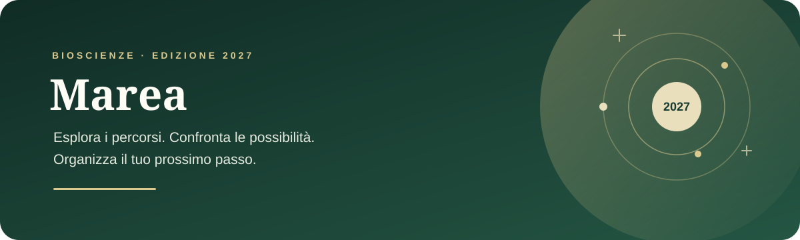

<p align="center">
  
</p>

<p align="center">
  <a href="https://master-atlas-profili-2027.fair-swan-2763.chatgpt.site/"><strong>Apri il sito pubblico</strong></a>
  ·
  <a href="master-atlas-2027/README.md">Guida tecnica</a>
  ·
  <a href="CONTRIBUTING.md">Contribuire</a>
</p>

<p align="center">
  <a href="https://github.com/micheledifiglia/coddiamo/actions/workflows/quality.yml"></a>
  <a href="https://master-atlas-profili-2027.fair-swan-2763.chatgpt.site/"></a>
  
</p>

# Marea

Un atlante interattivo per esplorare **208 percorsi magistrali in bioscienze**, confrontare le opzioni e organizzare le candidature. Riunisce in un’unica app le quattro classifiche del dossier originale, mantenendo visibili le differenze tra master, track, M1/M2 e programmi congiunti.

Le graduatorie sono valutazioni personali e qualitative: **non sono ranking ufficiali e non stimano le probabilità di ammissione**. Le condizioni di accesso e le offerte 2027 vanno verificate sui siti degli atenei.

## Cosa puoi fare

- Cercare e filtrare programmi per area, ateneo, tipologia e condizioni.
- Salvare preferiti e confrontare fino a quattro percorsi.
- Seguire ogni candidatura con scadenze, note e checklist.
- Gestire il profilo pubblico, aggiungere passkey, cambiare nome utente o eliminare il profilo.
- Importare ed esportare un backup dei propri progressi.
- Consultare il dossier, le note originali e la legenda delle sigle.

## Sito e dati personali

Marea ha un solo sito, [pubblico su Sites](https://master-atlas-profili-2027.fair-swan-2763.chatgpt.site/), con profili personali, passkey e sincronizzazione cloud. Il catalogo è pubblico; preferiti, candidature e note restano isolati nel rispettivo profilo e non sono visibili agli altri utenti.

## Avvio locale

Servono **Python 3.12** e **Node.js 24**. Dalla cartella del repository:

```powershell
cd master-atlas-2027
npm ci
npm test
npm run build
npm run preview
```

Apri `http://127.0.0.1:8790`. L’anteprima usa un database locale separato dal sito pubblico. Lo sviluppo dello schema D1 usa `npm run db:generate`. I dettagli sono nella [guida tecnica](master-atlas-2027/README.md).

## Struttura

```text
.
├── .github/workflows/       # controlli automatici
├── docs/media/              # grafica della pagina progetto
└── master-atlas-2027/
    ├── data/                # dossier sorgente e mappa degli ID legacy
    ├── db/                  # schema D1
    ├── drizzle/             # migrazioni del database
    ├── dist/                # sorgenti frontend e catalogo generato
    ├── scripts/             # build, anteprima e rilascio Sites
    ├── tests/               # test di regressione
    └── worker/              # API pubblica con profili e dati isolati per account
```

Il file autorevole dei contenuti è `master-atlas-2027/data/dossier.md`. Il catalogo in `master-atlas-2027/dist/data.json` viene rigenerato dal parser. Gli identificativi storici in `master-atlas-2027/data/legacy-ids.json` preservano i dati già salvati: non rigenerarli quando cambia l’ordine della classifica.

## Pubblicazione

Il sito pubblico ufficiale è [ospitato su Sites](https://master-atlas-profili-2027.fair-swan-2763.chatgpt.site/). GitHub Pages è stato disattivato; il repository rimane pubblico come sorgente del progetto. Ogni push su `main` avvia [GitHub Actions](https://github.com/micheledifiglia/coddiamo/actions) per rigenerare il catalogo ed eseguire i test, senza pubblicare un sito. Gli aggiornamenti del codice e la pubblicazione Sites sono passaggi distinti; la guida tecnica documenta il flusso.

## Origine dei dati

Il catalogo deriva dal dossier aggiornato al **16 ottobre 2026** e conserva le sue note, i collegamenti e le distinzioni tra tipologie di percorso. L’app non verifica automaticamente bandi, requisiti o disponibilità dei corsi.

## Licenza

Il codice e gli asset originali di Marea sono **tutti i diritti riservati in tutto il mondo**: pubblicare repository o sito non concede il permesso di copiarli, modificarli o riutilizzarli. Consulta [`LICENSE`](LICENSE). Software, dati e contenuti di terzi restano soggetti ai rispettivi termini.
